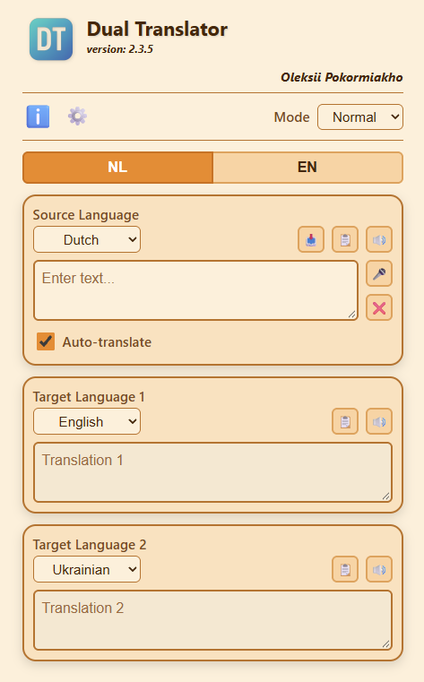

# Dual Translator

A lightweight, single-page web app that translates text into **two languages at once**. Type, paste or dictate your text once and read both translations side by side.



## Features

- **Two translations at once** – one source text, two target languages.
- **Auto-translate** – results appear as you type, or switch it off and use the Translate button.
- **Voice input and playback** – dictate with the microphone and listen to the source text or either translation.
- **Copy and paste tools** – paste from the clipboard, copy the source text or any translation, clear everything in one tap.
- **Configurations** – save up to 6 language sets (source + two targets) and switch between them with one tap.
- **Customizable buttons** – choose which buttons are visible for each configuration.
- **Themes** – many color palettes, each with Contrast, Normal, Evening and Night modes.
- **Multilingual interface** – Deutsch, English, Esperanto, Español, Français, Italiano, Nederlands, Polski, Português, Русский, Türkçe, Українська, with a built-in help window in each language.
- **Mobile friendly** – responsive layout with step-by-step scrolling on phones.
- **Remembers your settings** – everything is stored locally in the browser.

## Supported languages

German, English, Esperanto, Spanish, French, Italian, Dutch, Polish, Portuguese, Russian, Turkish, Ukrainian.

> Esperanto: translation works with all services, but voice playback depends on the voices installed on the device, and voice input (dictation) is usually not available for it in browsers.

## Getting started

No build step is required. Serve the folder over HTTP(S) and open `index.html`:

```bash
python -m http.server 8000
```

Then open <http://localhost:8000>.

> Voice input needs a browser with speech recognition support (e.g. Chrome or Edge) and a secure context (HTTPS or `localhost`). The help window loads its text with `fetch`, so opening the file directly via `file://` will not work.

## Default settings

The only place for default settings (theme, languages of the configurations, visible buttons, and so on) is `config/config.json`. (One copy of the default theme name also lives in `src/js/theme-boot.js`, because the theme must be set before the first paint; keep the two equal.) It is used on the first start and by the “Reset defaults” button. Every configuration lists all its buttons under `buttons` (sections `source`, `target1`, `target2`); set a button to `false` to hide it by default.

## Translation services

The default service is [MyMemory](https://mymemory.translated.net/) (free, with a daily limit). LibreTranslate and Google Cloud Translate are also supported in developer mode; Google requires your own API key in `src/js/core/config.js`; anyone can read it in the page source, so restrict the key to your site in Google Cloud. The developer panel shows how many characters MyMemory has translated today.

## Author

Oleksii Pokormiakho
