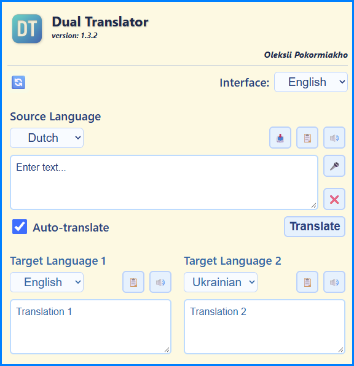

<p align="center">
  
</p>

# Dual Translator

**Version 1.3.2** · by Oleksii Pokormiakho

Dual Translator is a lightweight, mobile-friendly web app that translates one text into **two target languages at the same time**. Type or dictate once, and get both translations side by side, ready to copy or listen to.

It is built for people who regularly communicate in several languages, for example translating a Dutch message into English and Ukrainian in a single step.

## Features

- **Two translations at once** from a single source text
- **Auto-translate** while you type (700 ms debounce), or translate manually with a button
- **Voice input** (speech recognition) for the source text
- **Text-to-speech** for the source and both translations
- **Copy / paste / clear** buttons; copying uses the selected text if there is a selection
- **9 languages**: German, English, French, Dutch, Polish, Portuguese, Russian, Turkish, Ukrainian
- **Interface available in the same 9 languages**
- **Settings are remembered** in the browser (`localStorage`) and can be reset to the defaults from `script/config.json`
- **Switchable translation backends** (developer mode): MyMemory, LibreTranslate, Google Cloud Translate
- Responsive layout for phone, tablet and desktop

## How it differs from Google Translate

| | Dual Translator | Google Translate |
|---|---|---|
| Target languages per request | Two at once | One at a time |
| Translation engine | Pluggable: MyMemory, LibreTranslate or Google Cloud Translate | Google's own |
| Setup | Static files, no build step, no account | Hosted service |
| Defaults | Configurable via `config.json` | Fixed |
| Hosting | Self-hostable, easy to modify | Not self-hostable |

Dual Translator is not a replacement for Google Translate's full feature set (documents, images, offline mode, and so on). It is a small, focused tool for quickly getting the same text in two languages. Translation quality depends on the backend you choose.

## Getting started

No build or installation is required.

1. Clone or download this repository.
2. Serve the folder with any static web server, for example the VS Code **Live Server** extension (the project is configured for port `5501`).
3. Open `index.html` in your browser.

> **Note:** Speech recognition requires a secure context (HTTPS or `localhost`) and a supporting browser such as Chrome or Edge.

## Translation services

| Service | Notes |
|---|---|
| **MyMemory** (default) | Free API with a daily limit; basic translation quality |
| **LibreTranslate** | Open-source, community-hosted instance |
| **Google Cloud Translate** | Paid API, higher quality; requires your own API key |

To use Google Cloud Translate, set your key in `script/script.js`:

```js
const googleApiKey = "YOUR_GOOGLE_API_KEY";
```

> **Warning:** the app runs entirely in the browser, so the key is visible to anyone who opens the page. Restrict the key (HTTP referrers, API scope) in the Google Cloud Console, or proxy requests through your own backend.

The service selector is hidden by default. Enable it by setting `"developerMode": true` in `script/config.json` and resetting the settings with the 🔄 button.

## Configuration

Default settings live in `script/config.json`:

```json
{
  "uiLangSelect": "en",
  "sourceLang": "nl",
  "targetLang1": "uk",
  "targetLang2": "en",
  "serviceSelect": "mymemory",
  "autoTranslate": true,
  "developerMode": false
}
```

## Project structure

```
index.html              Main page
script/script.js        App logic (translation, speech, settings)
script/ui_DT_texts.js   Interface texts and language names
script/config.json      Default settings
styles/styles.css       Styles and responsive layout
icons/                  App icons
```

## Browser support

Translation works in any modern browser. Voice input depends on the Web Speech API (Chrome, Edge); text-to-speech depends on the browser's `speechSynthesis` support and installed voices.
