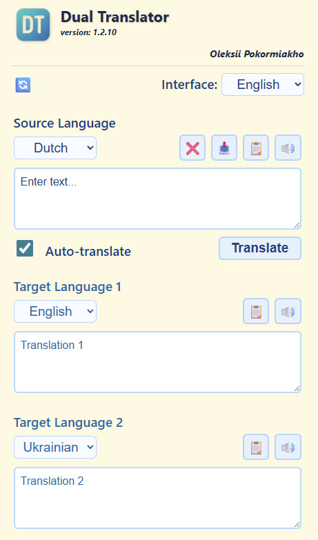

# Dual Translator

A lightweight, single-page web app that translates text into **two languages at once**. Type, paste or dictate your text once and read both translations side by side.



## Features

- **Two translations at once** – one source text, two target languages.
- **Auto-translate** – results appear as you type, or switch it off and use the Translate button.
- **Voice input and playback** – dictate with the microphone and listen to the source text or either translation.
- **Copy and paste tools** – paste from the clipboard, copy the source text or any translation, clear everything in one tap.
- **Configurations** – save up to 6 language sets (source + two targets) and switch between them with one tap.
- **Customizable buttons** – choose which buttons are visible for each configuration.
- **Themes** – many color palettes, each with Contrast, Normal and Night modes.
- **Multilingual interface** – Deutsch, English, Français, Nederlands, Polski, Português, Русский, Türkçe, Українська, with a built-in help window in each language.
- **Mobile friendly** – responsive layout with step-by-step scrolling on phones.
- **Remembers your settings** – everything is stored locally in the browser.

## Supported languages

German, English, French, Dutch, Polish, Portuguese, Russian, Turkish, Ukrainian.

## Getting started

No build step is required. Serve the folder over HTTP(S) and open `index.html`:

```bash
python -m http.server 8000
```

Then open <http://localhost:8000>.

> Voice input needs a browser with speech recognition support (e.g. Chrome or Edge) and a secure context (HTTPS or `localhost`). The help window loads its text with `fetch`, so opening the file directly via `file://` will not work.

## Translation services

The default service is [MyMemory](https://mymemory.translated.net/) (free, with a daily limit). LibreTranslate and Google Cloud Translate are also supported in developer mode; Google requires your own API key in `script/script.js`.

## Author

Oleksii Pokormiakho
