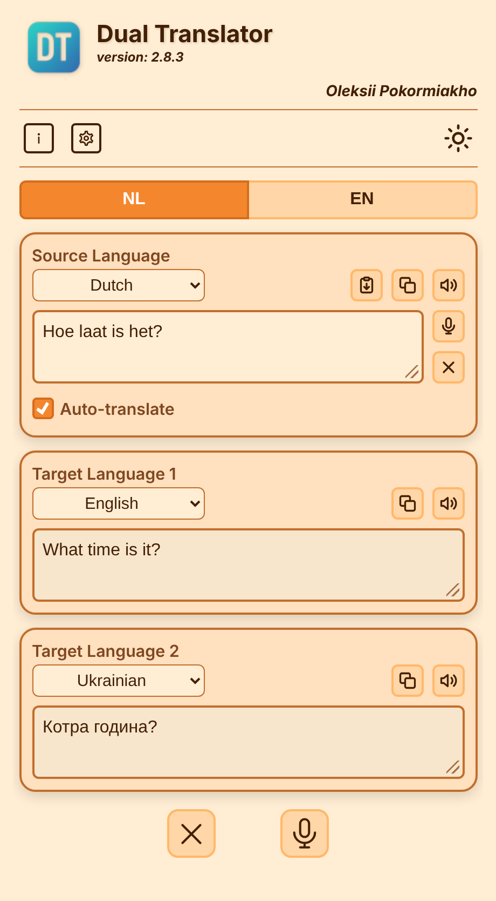
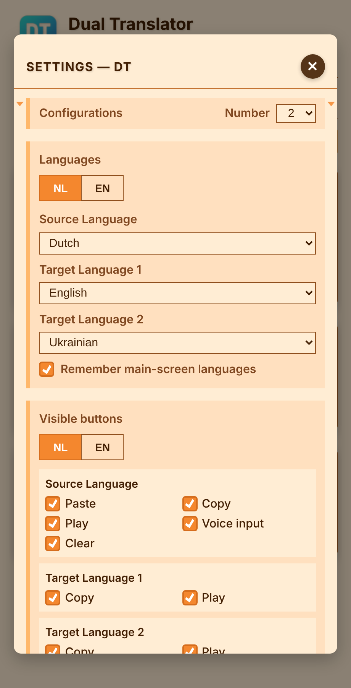

🌐 Beschikbare talen:  
[العربية](README.ar.md) | [Čeština](README.cs.md) | [Deutsch](README.de.md) | [English](README.en.md) | [Español](README.es.md) | [Français](README.fr.md) | [Italiano](README.it.md) | [Nederlands](README.nl.md) | [Polski](README.pl.md) | [Português](README.pt.md) | [Русский](README.ru.md) | [Türkçe](README.tr.md) | [Українська](README.uk.md)

---

# DT Dual Translator

Dit is een compacte applicatie op één pagina die tekst tegelijk in twee talen vertaalt.  
Typ, plak of dicteer de tekst één keer en lees, kopieer of beluister beide vertalingen naast elkaar.

## Functies

- Vertaalt tegelijk naar twee talen; met automatisch vertalen verschijnen de vertalingen terwijl je typt.
- Tot zes configuraties: snelle tabs op het hoofdscherm, elk met zijn drie talen en eigen zichtbare knoppen.
- Spraakinvoer en voorlezen van de brontekst en beide vertalingen, plus knoppen voor kopiëren, plakken en wissen.
- Gebruikt de gratis dienst MyMemory, zonder account (er geldt een daglimiet).
- Werkt op telefoons en computers, in 13 interfacetalen, met 10 kleurthema’s in vier modi (normaal, avond, nacht, contrast).

## Instellingen

Het instellingenvenster bevat de configuraties (talen en zichtbare knoppen per tab), de interfacetaal, het thema en de modus, en terugzetten naar de standaardwaarden.

## Aan de slag

Open de app in je browser: https://oleksiypok.github.io/DT/. Er hoeft niets geïnstalleerd te worden en je instellingen worden in de browser opgeslagen.

---

🌐 Beschikbare talen:  
[العربية](README.ar.md) | [Čeština](README.cs.md) | [Deutsch](README.de.md) | [English](README.en.md) | [Español](README.es.md) | [Français](README.fr.md) | [Italiano](README.it.md) | [Nederlands](README.nl.md) | [Polski](README.pl.md) | [Português](README.pt.md) | [Русский](README.ru.md) | [Türkçe](README.tr.md) | [Українська](README.uk.md)
